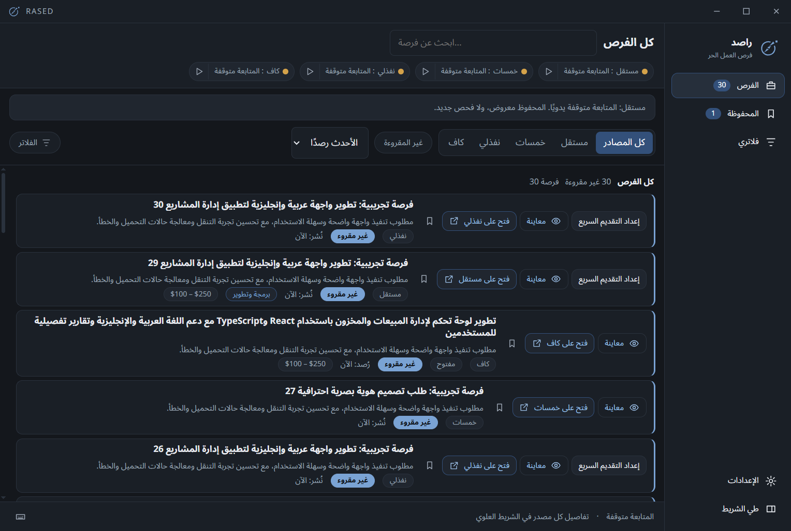

# RASED · راصد

تطبيق Windows محلي لمتابعة فرص العمل الحر من **مستقل ونفذلي وخمسات وكاف**، بواجهة عربية وإنجليزية وتنبيهات سطح المكتب. لا يحتاج سيرفر أو حساب راصد.

[تحميل آخر إصدار](https://github.com/deved234/rased/releases/latest) · [سجل التغييرات](CHANGELOG.md) · [المساهمة](CONTRIBUTING.md) · [الإبلاغ عن مشكلة](https://github.com/deved234/rased/issues)



[دليل الواجهة والتنقل وحفظ التعديلات](docs/INTERFACE.md)

لقطة فعلية للواجهة ببيانات تجريبية، دون حسابات أو معلومات شخصية.

## التحميل والتشغيل

حمّل **RASED-Setup-0.11.0.exe** من قسم **Assets** في صفحة الإصدار، ثم شغّل المثبت على **Windows x64**. لا تحتاج Node.js أو SQLite؛ ملفات Source code للمبرمجين فقط. المثبت غير موقّع حاليًا، وقد يعرض Windows تحذيرًا. تأكد من مصدر التحميل وقارن البصمة بملف `SHA256SUMS.txt`:

```powershell
Get-FileHash -Algorithm SHA256 -LiteralPath '.\RASED-Setup-0.11.0.exe'
```

أول فحص ناجح لكل منصة يحفظ الموجود دون تنبيهات قديمة. بعدها ينبهك بالجديد بحسب فلاترك. إغلاق النافذة يبقي الرصد في الخلفية؛ للخروج الكامل استخدم قائمة أيقونة راصد بجوار الساعة. النقر على إشعار المشروع يفتح رابطه في المتصفح الافتراضي.

من **الإعدادات ← تحديثات راصد** يمكنك تحميل التحديث ثم إعادة التشغيل والتثبيت. أصحاب 0.2.4 أو أقدم يحتاجون تثبيتًا يدويًا مرة واحدة. [دليل التحديث](docs/UPDATES.md).

## المزايا

- رصد مستقل عبر RSS، ونفذلي عبر RSS، وطلبات الخدمات غير الموجودة بخمسات عبر الصفحة العامة؛ تحكم مستقل في إيقاف وتنبيهات كل مصدر.
- **كاف:** رصد القائمة العامة وتنبيهات الفرص المفتوحة، متاح بدءًا من 0.7.0، مع إيقاف وتنبيهات مستقلة وتفاصيل عند الطلب. [دليل كاف](docs/KAF.md).
- بحث وفلاتر محفوظة ومعاينة جانبية وتفاصيل المشروع وملاحظات ومحفوظات محلية.
- واجهة عربية RTL وإنجليزية LTR، وضع داكن وفاتح، ونافذة متابعة صغيرة.
- **مساعد العروض:** Gemini وOpenAI وClaude بمفتاحك الخاص، واختيار الموديل ومعاينة البيانات قبل إنشاء مسودة قابلة للتعديل. لمشاريع مستقل ونفذلي وكاف؛ كاف للنسخ وفتح الرابط فقط، وخمسات غير مشمول. [دليل المساعد](docs/AI_ASSISTANT.md).
- **التقديم السريع:** إضافة Chrome مجانية تُحمّل يدويًا مرة واحدة، وتعبئ قالبك والسعر والمدة في مستقل ونفذلي. تراجع وتضغط تقديم بنفسك؛ خمسات وكاف غير مشمولين بتجهيز Chrome. [التركيب والاستخدام](docs/QUICK_APPLY.md).

الجلب يتباطأ عند الأخطاء ويحترم `Retry-After`. زمن النشر والشبكة خارج سيطرة راصد؛ لا ضمان للرصد الفوري أو السبق على المنافسين. Windows يتحكم في ظهور الإشعارات أثناء الألعاب وعدم الإزعاج.

## للمبرمجين

المتطلبات: **Windows x64، Node.js 24، npm**. Electron وSQLite ضمن الاعتماديات.

```powershell
git clone https://github.com/deved234/rased.git
cd rased
npm ci
npm run dev
```

يفتح الأمر نافذة Electron مستقلة؛ `localhost:5173` خادم React الداخلي. أول تشغيل قد يستغرق أطول لتحميل Electron وبناء ملفات إضافة Chrome.

```powershell
npm run typecheck
npm run lint
npm test
npm run build
npm run test:e2e
npm run test:search
npm run test:ai
npm run test:quick-apply
npm run test:data
npm run test:monitoring
npm run test:project-facts
npm run test:telemetry
npm run dist
```

`dist` ينشئ المثبت داخل `release/` دون نشر. اختبارات التكامل تستخدم ملفات مؤقتة وبيانات وهمية؛ لا تستخدم حساباتك أو مفاتيحك. [دليل المساهمة](CONTRIBUTING.md) يشرح الاختبارات الإضافية و[المعمارية](docs/ARCHITECTURE.md) تشرح تنظيم الكود. خطط العمل والمراجعات الداخلية وأدلة QA المولّدة ليست جزءًا من المستودع العام.

إصدار **0.11.0** يضيف التقديم السريع بضغطة واحدة، وإعادة استخدام المسودة أو توليدها بموافقة AI اختيارية قابلة للسحب، وحتى عشرة ملفات مهنية مع ملف افتراضي. يدعم مساعد العروض مستقل ونفذلي وكاف؛ كاف للنسخ وفتح الرابط فقط، وتجهيز Chrome لمستقل ونفذلي فقط، وخمسات غير مشمول. يتضمن شاشة «الجديد» وأخطاء أوضح وشروطًا وخصوصية بتاريخ 2026-10-23. إفصاح الإحصائيات v4 لم يتغير ولا توجد حقول إحصائية جديدة؛ منذ 0.10.0 تبقى الموافقة شرطًا لاستخدام النسخة الرسمية، والتحقق من الحذف السحابي ما زال معلّقًا. ملفات الإعدادات v3 والنسخ التي تتضمن مجموعة ملفات مهنية لا تُستورد في 0.10.0؛ راجع حدود الرجوع في [تفاصيل الإصدار](docs/RELEASE_0.11.0.md) و[دليل حماية البيانات](docs/BACKUP_AND_RESTORE.md). [دليل الإحصائيات](docs/ANALYTICS.md) · [سجل التغييرات](CHANGELOG.md).

تفاصيل نقل الإعدادات والنسخ الاحتياطي والاستعادة موجودة في [دليل حماية البيانات](docs/BACKUP_AND_RESTORE.md).

إدارة المنصات والتعطيل المحفوظ والإيقاف المؤقت وحالات الاتصال وتحذيرات الفجوات موضحة في [دليل صحة الرصد](docs/MONITORING_HEALTH.md).

جلب الميزانية ومدة التنفيذ وحالات البيانات الناقصة في المعاينة والتفاصيل موضحة في [دليل بيانات المشروع](docs/PROJECT_DETAILS.md).

البحث في الأوصاف المحفوظة، والبحث الاختياري في ملاحظاتك ومسودات عروضك، وسلوك النتائج الجديدة موضحة في [دليل البحث](docs/PROJECT_SEARCH.md).

## الخصوصية والترخيص

البيانات محلية في `%APPDATA%\RASED`. النسخة الرسمية من 0.10.0 تشترط موافقتك الصريحة على إرسال إحصائيات محدودة إلى PostHog قبل الاستخدام، ويمكنك الخروج بدلًا من الموافقة أو سحبها لاحقًا. لا يوجد حذف دوري من راصد؛ يمكن طلب حذفها مع مراعاة سياسات المزود ومتطلبات القانون. التحقق النهائي من اكتمال حذف الأحداث لدى المزود لم يكتمل بعد، وهذا موضح قبل الموافقة؛ يمكن إيقاف الإرسال وطلب الحذف من الإعدادات. [دليل الإحصائيات وحدود الأرقام](docs/ANALYTICS.md). يتصل الجهاز بالمنصات وGitHub، وبموفر AI المختار عند استخدامه. مفاتيح AI مشفرة بتشفير Windows؛ قاعدة البيانات والملاحظات ليست مشفرة بواسطة التطبيق. اقرأ [الخصوصية](PRIVACY.md) و[الشروط](TERMS.md) قبل الاستخدام.

راصد مستقل عن المنصات ولا يمثلها. [MIT](LICENSE) يخص الكود ولا يمنح حقوقًا في محتوى المنصات أو إذنًا باستخدامها. [رخص المكونات](resources/legal/THIRD_PARTY_NOTICES.txt) مرفقة بالتوزيع.

تطوير **david atef** · [GitHub](https://github.com/deved234) · [LinkedIn](https://www.linkedin.com/in/david-atef/).

## English

RASED is a local Windows desktop app monitoring freelance opportunities on Mostaql, Nafezly, Khamsat and KAF. It offers Arabic/English UI, independent source controls, desktop alerts, filters, previews and local notes.

Download **RASED-Setup-0.11.0.exe** from [Releases](https://github.com/deved234/rased/releases/latest). End users need neither Node.js nor SQLite. The installer is unsigned; verify its source and SHA-256 checksum. Existing users on 0.2.5+ can update inside Settings → RASED updates. Since 0.10.0 the official build requires accepting limited usage analytics (**Agree & use RASED** or **Exit**) before monitoring or any feature starts. 0.9.1 participants accept again, and earlier declines stay declined. Development builds are exempt and send nothing. Cloud-deletion verification is still pending. Version **0.11.0** adds one-click Quick Apply, saved-draft reuse or generation under optional revocable AI consent, up to ten freelancer profiles with a default, Nafezly/KAF Proposal Assistant support, a What's New screen and clearer extension guidance. Terms and Privacy are dated 2026-10-23; analytics disclosure v4 and analytics fields are unchanged. Settings v3 and backups containing profile sets cannot be imported by 0.10.0. See the [0.11.0 release notes](docs/RELEASE_0.11.0.md) for downgrade limits and the [analytics guide](docs/ANALYTICS.md).

The optional [Proposal Assistant](docs/AI_ASSISTANT.md) supports Gemini, OpenAI and Claude with your own API keys and model selection, for Mostaql, Nafezly and KAF projects; KAF offers copy and open only, and Khamsat is excluded. [Quick Apply](docs/QUICK_APPLY.md) uses a manually installed Chrome extension for Mostaql/Nafezly only. It fills a draft using your normal browser session and **never submits it**. Monitoring needs no platform login; browser form filling does.

For development, use Windows and Node.js 24, then `npm ci` and `npm run dev`. See [Contributing](CONTRIBUTING.md), [Architecture](docs/ARCHITECTURE.md), [Privacy](PRIVACY.md), [Terms](TERMS.md) and [MIT](LICENSE). API contracts and app integration are tested with fixtures; live provider accounts and every model are not certified.
