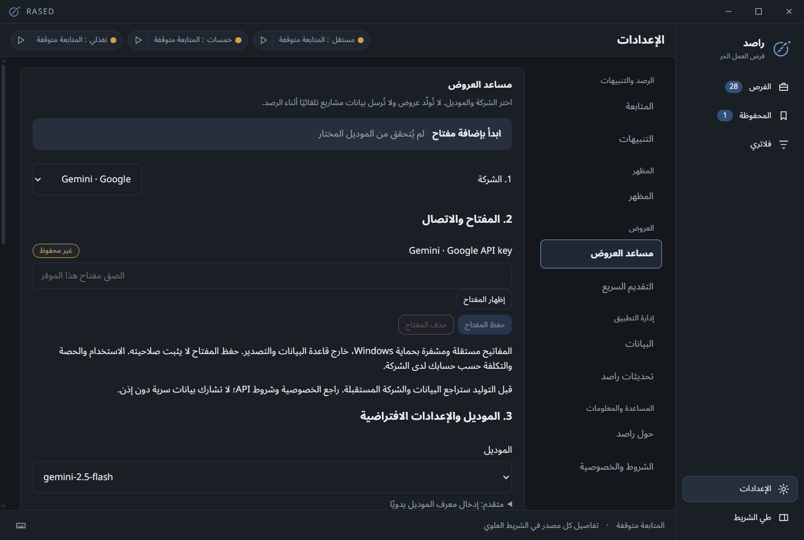

# Proposal Assistant

The assistant creates editable proposals for **Mostaql, Nafezly and KAF projects**. Khamsat is not supported. Gemini, OpenAI and Anthropic Claude are supported directly. API access and consumer chat subscriptions are separate; quotas and billing belong to your provider account.

## Configure and generate

1. Open Settings → Proposal Assistant. Choose a provider and save its API key. Saved means stored, not validated against the provider.
2. Request a model-list refresh, then select a model. Advanced settings accept a manual model ID with compatibility warnings; catalog visibility does not prove generation access.
3. Create a named freelancer profile with your real specialization, experience, relevant work and preferred proposal style. Save it and choose your default. Do not invent credentials or promise unavailable services.
4. Optionally use Test generation. It sends synthetic data, requires confirmation, may consume quota and saves no draft.
5. From a Mostaql, Nafezly or KAF project, open the assistant. You can temporarily choose another profile and provider/model for this draft without changing the defaults.
6. Review the outgoing project text, freelancer profile and instructions, then explicitly generate. Edit/copy the draft and submit it yourself on the platform.

## Data and behavior

Each provider has a separate Windows-encrypted key under the local app-data directory. Keys are not included in settings exports. Existing Gemini keys migrate only after a verified replacement. Older drafts and profiles remain available; new drafts record provider/model provenance.

The preview is built from data RASED already stores: a full saved detail description when one exists, otherwise the stored description or excerpt. The assistant performs no extra project fetch and does not bypass source pause, backoff or cooldown. The preview labels whether the text is full, truncated (over 15,000 characters) or an excerpt, and a missing category (common for Nafezly) is shown as absent rather than invented. KAF descriptions are the locally cached detail text.

Network hosts are fixed HTTPS endpoints. One generation request runs at a time; generation times out after 45 seconds and catalog loading after 15 seconds. Cancellation, changing the key or leaving the generation view prevents a late response from becoming a saved draft. There is no automatic paid retry or fallback to another company.

The app uses Gemini generateContent, OpenAI Responses (`store:false`) and Claude Messages. Provider retention policies still apply; `store:false` does not promise zero retention. Read [Privacy](../PRIVACY.md).

## Verification and limitations

Provider request/response contracts, errors, cancellation, encrypted storage, migration and real Electron/React/SQLite wiring are tested with synthetic API responses. **Live API calls for this multi-provider release have not been verified with real keys.** Use the in-app test with your own account; do not send keys to the maintainer.

Unknown/new models may reject parameters or produce invalid/truncated output. The app reports the error rather than saving an incomplete draft or making another paid request. Model availability, cost and Arabic proposal quality depend on the provider and account.

On a brand-new Windows profile, forcibly killing the app before its first normal exit can prevent Chromium from persisting encryption state. Keys may then require re-entry. A normal first exit and restart preserve keys; crash-proof storage is not guaranteed.

## Editing safely

Provider selection, key storage, model defaults and your freelancer profile are separate steps. Keys are masked, with an optional Show/Hide control. “Key saved” is different from a successfully tested model; requesting a generation test asks for confirmation because it can consume provider credits or quota.

Explicitly save each group. Navigation protects an edited profile, unsaved key, changed defaults and edited proposal text. Failed saves retain edits; saving and continuing proceeds only after success. Project previews show readable profile fields, and copying a proposal excludes separate assumptions/questions. Changing request input or model requires a new preview and consent.

## Quick Apply integration

The Mostaql and Nafezly **Quick Apply with Assistant** action reuses the latest saved draft without an AI call. If no draft exists, optional standing consent allows one generation followed by saving and Chrome preparation in main. Otherwise, the Assistant page opens with the reason and keeps manual preview/consent. The proposal page's **Prepare in Chrome with this proposal** saves edits, freezes the editor until activation returns and verifies the exact displayed text; there is no preview dialog or per-job price override. KAF has no Chrome preparation: its proposal page offers copy and open only.

Standing consent is off by default in Assistant settings. Its disclosure names the active provider and model: each click without a saved draft sends public project data and the freelancer profile without preview, excludes private and proposal-specific notes, and may incur provider charges/quotas. Review and submit yourself in Chrome. Consent is tied to the provider, model and key revision; changing the active selection, saving/deleting any key, importing settings or restoring a backup clears it. It is excluded from exports/backups and can be withdrawn in one click, cancelling its current operation. Analytics acceptance remains separate.

Generation shares the manual flow's busy guard, 45-second timeout, cancellation and telemetry. It reserves Quick Apply while writing, cannot overwrite a draft saved concurrently, and never retries a paid call automatically. Draft reuse emits no generation event. Failed Chrome preparation keeps generated text. Output over 10,000 and up to 12,000 characters is saved for shortening; output over 12,000 is rejected without saving. Hiding to the tray continues; exiting cancels. Quick Apply and Quick Apply with Assistant support Mostaql/Nafezly only; the manual Assistant covers Mostaql, Nafezly and KAF. Khamsat remains excluded, and KAF has no Quick Apply or Chrome preparation.

## Multiple freelancer profiles

Assistant settings hold 1–10 named profiles (names 1–60 characters), each with skills, experience, portfolio, tone, language and an optional Quick Apply template of up to 10,000 characters. Add or edit profiles and save explicitly. Set another saved profile as default before deleting the current default; the last profile cannot be deleted. Unsaved profile, key and model edits remain protected when navigating.

The default supplies Quick Apply templates (including notifications) and new Assistant generation under standing consent. Changing the default does not revoke standing consent or alter saved drafts. Manual Assistant requests start with the default and allow a different profile for that request only; switching refreshes the preview and clears per-request approval. Only the five professional-fact fields are sent to the AI provider, never profile names, IDs, templates or other profiles. There is no category-based selection.

An unreadable or unsupported stored profile set is preserved. Settings show the legacy profile read-only, and generation/preparation temporarily use it. “Recreate from legacy profile” replaces the damaged set only after confirmation. Export/backup refuses an unreadable set rather than silently dropping it.
