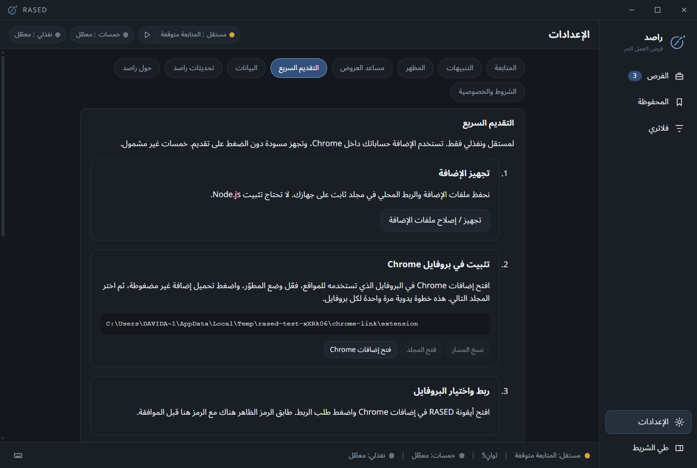

# Chrome Quick Apply

Quick Apply fills a saved proposal on **Mostaql and Nafezly** using your normal Chrome session. Khamsat and KAF are not supported: they have no Quick Apply buttons and no Chrome preparation. On KAF the Proposal Assistant offers copy and open only.

## Requirements, installation and compatibility

- **Chrome 120 or newer.** The extension manifest declares `minimum_chrome_version` 120.
- **Supported sites:** Mostaql and Nafezly only. Khamsat and KAF are never included.
- **Untested browsers:** Microsoft Edge, Brave and other Chromium browsers are untested and may not work. Only Google Chrome is supported.
- The extension is free and loaded manually. RASED cannot silently install it or enable Chrome developer mode for you.
- RASED must be running, and the same Chrome profile must be paired, when you prepare.

### Install and pair once per Chrome profile

1. Open RASED Settings → Quick Apply → Prepare extension files.
2. Open Chrome's extensions page from RASED, enable **Developer mode**, then choose **Load unpacked**. Select the folder displayed by RASED; use Copy path if needed.
3. Open the RASED extension from Chrome's toolbar and request pairing.
4. Match the six-digit code shown in Chrome with the code in RASED. Approve and name the profile, then select it as the destination.
5. Save the Quick Apply template in your default freelancer profile under Assistant settings, then save budget position (0–100%) and extra days under Quick Apply settings. Enable Quick Apply. Sign in to the platforms in this same Chrome profile, including Google sign-in if desired.

### Reload after updates

After updating RASED or its extension files, use Prepare/repair files if needed, then press **Reload** for the unpacked extension on Chrome's extensions page. Chrome never auto-updates an unpacked extension from the store, and a stale worker cannot be trusted to fill forms.

## Use

Click **Prepare draft** on a supported project card/details or its individual Windows notification when available. RASED sends the saved template to the selected paired profile, opens the project and fills the form where supported. **Review all fields and press the platform's submit button yourself. RASED never submits the offer.** The notification body and View project action open the ordinary project URL in your default browser.

Price = minimum + (maximum − minimum) × percentage / 100, adjusted to the form's accepted step/range. For $25–50, 0% selects $25 and 100% selects $50. Duration = the client's available duration + your extra days. Missing/invalid data is left for manual review, not fabricated.

An existing draft is preserved. Clear/edit it yourself before starting another fill. Repeated clicks focus a known open project tab rather than refill it. Disabling the feature or revoking/changing the destination cancels pending work.

## Direct preparation and Assistant

**Quick Apply** on cards and details prepares the saved global template in one click. Windows notifications also use the template. Budget position and extra days always come from Settings; there is no preview dialog or one-time override.

On **Mostaql and Nafezly**, **Quick Apply with Assistant** uses the latest saved project draft at activation. If none exists, optional standing consent and a readable key allow generation, local saving and Chrome preparation as one operation. Without consent or a key, the Assistant page explains what is missing and retains manual per-request approval. Writing progress offers Cancel; both actions are disabled while generation or preparation is active. Hiding to the tray continues the operation; exiting cancels it.

The Assistant page's **Prepare in Chrome with this proposal** saves edits and prepares directly. Editing is locked during save/preparation, and main verifies the exact displayed text against the saved draft. A concurrent draft change returns `text-changed`. Unsaved-note navigation guards remain active.

Drafts above **10,000 characters** stay saved but cannot be prepared; shorten them in the Assistant. Provider output above 12,000 characters is rejected without saving. Failed Chrome preparation keeps a successfully generated draft. Missing, empty or changed drafts never fall back to the template. Review every field in Chrome and submit yourself. The extension and native protocol are unchanged; no extension reload is needed for this feature.

### Preparation phases and what to do

| Phase | Meaning | What to do |
|-------|---------|------------|
| `waiting-client` | RASED is waiting for the selected paired Chrome profile to connect (20-second limit). | Open the selected Chrome profile; if the job expires, prepare again. |
| `opening` | Chrome is opening the project page and starting the fill. | Wait and keep the profile open. |
| `reading` | The extension is reading the form and filling the proposal fields. | Wait and keep the project tab open. |
| `ready` | The draft is in the form; nothing has been submitted. | Review every field in Chrome and press the site's submit button yourself. |
| `needs-input` | Price or duration could not be filled automatically (missing/invalid budget or duration, or form constraints). | Complete the missing values in Chrome, then submit yourself. |
| `needs-login` | The site asked for a login session. | Sign in on the site in the selected Chrome profile, then retry. |
| `draft-exists` | The proposal form already had content, so RASED preserved it instead of overwriting. | Review and submit the existing draft, or clear it, then retry. |
| `failed` | Preparation stopped; the accompanying error code explains why. | Follow the matching error row below and retry. |
| `cancelled` | The job was cancelled by you, unpairing, disabling or another explicit cancel. | Retry when ready. |
| `expired` | The selected profile did not connect in 20 seconds, or the form did not finish in 30 seconds. | Open the selected profile and prepare again; finish in Chrome. |

### Error codes: cause and what to do

Errors can appear on the project action, in Quick Apply settings, on the Assistant page, or as the detail line under a failed phase. Delegated AI provider codes keep the same text on the Assistant page.

| Code | Cause | What to do |
|------|-------|------------|
| `blocked` | The calling window may not act (for example before required analytics acceptance, or a non-main window). | Accept usage analytics on the RASED start screen (or use the main RASED window), then retry. |
| `not-ready` | Extension files are not prepared or no paired Chrome client is connected. | Complete extension setup and pairing in Settings → Quick Apply, then retry. |
| `disabled` | Quick Apply is turned off in Settings. | Enable Quick Apply in Settings → Quick Apply. |
| `busy` | Another preparation, generation or model test is already running. | Wait for it to finish or cancel it, then retry. |
| `unsupported-source` | The project is not Mostaql or Nafezly; Khamsat and KAF are excluded. | Use the manual Proposal Assistant for KAF; no Chrome preparation is available for KAF or Khamsat. |
| `invalid-project` | The project is unknown, its URL is not a valid supported destination, or the project changed during preparation. | Reopen the project from the list, then retry. |
| `text-missing` | No saved draft or template text was found for the requested mode. | Save a draft for this project or add a template to the default profile. |
| `text-changed` | The saved draft or displayed editor text changed after preparation started, or a concurrent save won. | Reopen the draft, check the text, then retry. |
| `text-empty` | The chosen template is empty. | Add a template to the default profile or use Quick Apply with Assistant. |
| `draft-empty` | A saved draft exists but contains no text. | Edit or delete the empty draft in the Proposal Assistant; Quick Apply with Assistant reuses it. |
| `text-too-long` | The proposal text exceeds 10,000 characters. | Shorten the text, then retry. |
| `message-too-large` | The text is too large for the native-messaging bridge (64 KiB frame). | Shorten the text, then retry. |
| `chrome-unavailable` | Chrome could not be started. | Open the selected Chrome profile yourself, then retry. |
| `login-required` | The site shows a login page in the selected Chrome profile. | Sign in on the site in that profile, then retry. |
| `form-unavailable` | The proposal form fields were not found on the project page. | Keep the project page open, reload it, then retry. |
| `template-too-long` | The text exceeds the site form field's maximum length. | Shorten the template or proposal to fit the site field, then retry. |
| `client-timeout` | The selected Chrome profile did not connect within 20 seconds. | Open the selected profile yourself, then retry. |
| `form-timeout` | The extension did not finish filling the form within 30 seconds. | Prepare again, then finish the remaining fields in Chrome. |
| `connection-lost` | The connection to the Chrome extension or native helper dropped. | Reload the extension and retry. |
| `tab-closed` | The project tab was closed during preparation. | Retry and keep the project tab open. |
| `navigation-changed` | The tab left the project page during preparation. | Retry and stay on the project page. |
| `user-cancelled` | Preparation was cancelled before it completed. | Retry when ready. |
| `app-restarted` | RASED restarted and stopped jobs that were in progress. | Prepare again. |
| `consent-required` | Quick Apply with Assistant has no saved draft and optional standing consent is off. | Enable standing consent in Assistant settings or approve this request on the Assistant page. |
| `no-key` | Quick Apply with Assistant has no readable API key for the active provider. | Add the active provider's key in Assistant settings, or rely on a saved draft. |
| `generation-failed` | Generation failed for a reason that is not a mapped provider code. | Open the Assistant page, review the message, then retry manually. |
| `bad-request` | The provider or model selection is invalid. | Choose a supported provider and model in Assistant settings. |
| `key-missing` | No saved API key was found for the provider. | Save this provider's API key in Assistant settings. |
| `key-unreadable` | The stored key cannot be decrypted on this device. | Save the key again on this device. |
| `key-save-failed` | The key or its protected file could not be saved or deleted safely. | Retry saving the key; check the app-data folder is writable. |
| `auth-rejected` | The provider rejected authentication. | Check the key in the provider dashboard, then save a valid key. |
| `access-denied` | The account lacks permission for this request or region. | Check account permissions and region with the provider. |
| `model-unavailable` | The model ID is unavailable for this account. | Refresh the model list or choose another model. |
| `unsupported-model` | The selected model does not support proposal drafting. | Choose a text-generation model from the refreshed list. |
| `invalid-request` | The provider rejected the request configuration for this model. | Refresh models and retry with a compatible model. |
| `quota-exceeded` | Provider quota or credits are exhausted. | Check billing and quota in the provider account. |
| `rate-limited` | Too many requests were sent temporarily. | Wait for the provider's retry window, then try again. |
| `provider-unavailable` | The provider service is temporarily unavailable. | Retry later; there is no automatic paid retry. |
| `network-error` | RASED could not reach the provider. | Check the connection, then retry manually. |
| `timeout` | The provider request exceeded 45 seconds. | Retry later; a timed-out request may still have consumed quota. |
| `cancelled` | The AI request or preparation was cancelled. | Retry when ready. |
| `response-blocked` | The provider refused or did not complete the response. | Review the project text and profile, then retry. |
| `output-truncated` | The draft hit the provider's output limit. | Retry or use a shorter project text/model with a higher limit. |
| `invalid-response` | The provider response was not a usable draft. | Retry manually; no partial draft was saved. |
| `response-too-large` | The provider response exceeded the safe 2 MiB limit. | Retry or reduce the input; no draft was saved. |
| `preview-changed` | Project data, the profile, provider or model changed after approval. | Refresh the preview and approve the request again. |

## Troubleshooting and updates

- Keep RASED running and use the selected paired Chrome profile. If Chrome opens another profile, switch to the paired one and retry explicitly. Automatic selection of a closed profile is not guaranteed.
- If the login page appears, sign in normally, return to the project and retry. No passwords/cookies are transferred into RASED.
- After updating RASED, use Prepare/repair files if needed, then **Reload** the unpacked extension in Chrome. Chrome does not update an unpacked extension from the store.
- Site changes, protection challenges, missing fields or expired jobs may require manual completion. No claim of faster submission than every competitor is made.
- To remove it, revoke pairing in RASED and remove the extension from Chrome. Uninstalling RASED does not automatically remove browser extensions or retained local user data.

The packaged native-messaging helper includes its runtime; end users do not need Node.js. Communication is local and authenticated. Pairing tokens protect transport; this does not defend against malware running as the same Windows user or administrator.

Automated verification uses real Chromium, the native executable and broker with intercepted fixture pages. It is not a live account/form test or proof of physical Windows notification activation. See [Privacy](../PRIVACY.md) and [Terms](../TERMS.md).

## Status and saving

Settings distinguish a paired profile from a currently connected profile. Setup steps collapse after pairing and remain available under pairing management. Save the template in Assistant → Freelancer profiles, and budget position and extra days in Quick Apply settings; navigating away offers Save and continue, Discard edits, or Stay here. A failed save keeps your edits.

An unpaired project action opens setup; a deliberately disabled feature opens its settings. Preparation status appears beside the matching project and in settings: waiting, opening, reading, ready, login needed, manual input, preserved draft, failure or timeout. Cancel is available only while a job is active. A ready draft still needs your review and manual submission in Chrome.

## Default freelancer profile

Quick Apply buttons and notification tickets always use the default freelancer profile’s saved template. Quick Apply settings link to that profile rather than editing the template. There is no profile selector in Quick Apply. Enabling Quick Apply with an empty template is allowed: a template action reports “Add a template to the default profile or use Quick Apply with Assistant” without opening Chrome. Notification activation shows the same message and opens Assistant settings. Saved-draft preparation and Assistant generation under standing consent still work with an empty default template. Existing project drafts do not change when you switch defaults.
